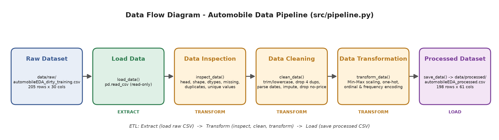

# Data Preparation & Pipeline Project — Automobile Dataset

Pipeline ETL berbasis Python + Pandas yang mengubah dataset otomotif mentah (`automobileEDA_dirty_training.csv`) menjadi *processed dataset* yang siap dipakai untuk analisis atau pemodelan (misalnya prediksi `price`).

> AI Engineering Bootcamp — Data Engineering: Pipeline & Preparation (Individual Assignment)

---

## 1. Deskripsi & Sumber Dataset

| Item | Keterangan |
|---|---|
| Sumber | `Dataset_Sesi_3.zip` dari mentor (berbasis *UCI Automobile Data Set*, versi hasil EDA) |
| File input | `data/raw/automobileEDA_dirty_training.csv` |
| Isi | Spesifikasi teknis mobil (merek, bodi, mesin, dimensi, konsumsi BBM) beserta harga dan tanggal transaksi |
| Ukuran awal | **205 baris × 30 kolom** |
| Target potensial | `price` |

Kolom `length` dan `width` di file mentah sudah dalam bentuk ternormalisasi (0–1) dari tahap EDA sebelumnya, jadi tidak di-scale ulang.

## 2. Struktur Folder

```
data-pipeline-assignment/
├── data/
│   ├── raw/
│   │   └── automobileEDA_dirty_training.csv   # input, tidak pernah diubah
│   └── processed/
│       └── automobileEDA_processed.csv        # output pipeline
├── src/
│   └── pipeline.py                            # pipeline ETL
├── documentation/
│   ├── data-flow-diagram.png
│   └── make_diagram.py                        # script pembuat diagram
├── README.md
└── requirements.txt
```

## 3. Cara Menjalankan

```bash
# 1. (opsional) buat virtual environment
python -m venv .venv
# Windows
.venv\Scripts\activate
# macOS / Linux
source .venv/bin/activate

# 2. install dependency
pip install -r requirements.txt

# 3. jalankan pipeline dari root project
python src/pipeline.py
```

Hasil inspeksi, cleaning, dan transformasi ditampilkan di terminal; file hasil ditulis ke `data/processed/automobileEDA_processed.csv`. Pipeline bisa dijalankan berulang kali dan hasilnya selalu sama. Diagram bisa dibuat ulang dengan `python documentation/make_diagram.py`.

## 4. Alur ETL



| Tahap | Function | Proses |
|---|---|---|
| **Extract** | `load_data()` | Membaca CSV dari `data/raw/` (hanya baca) |
| **Transform** | `inspect_data()` | Pemeriksaan awal: 5 baris pertama, ukuran, nama kolom, tipe data, missing values, duplikat, nilai unik kategori, format tanggal, outlier |
| | `clean_data()` | Menyeragamkan teks, menghapus duplikat, mem-parse tanggal, menangani missing values, memperbaiki tipe data |
| | `transform_data()` | Min-Max scaling dan encoding kategori |
| **Load** | `save_data()` | Menyimpan hasil sebagai file baru di `data/processed/` (menolak menimpa file raw) |

`run_pipeline()` menjalankan semua tahap di atas berurutan dalam satu eksekusi.

## 5. Kondisi Awal Dataset (Hasil Inspeksi)

- **Ukuran:** 205 baris × 30 kolom (11 kolom teks, 11 float, 8 integer).
- **Missing values: 17 sel** di 7 kolom:

  | Kolom | Missing |
  |---|---|
  | `stroke` | 4 |
  | `horsepower` | 3 |
  | `price` | 3 |
  | `transaction_date` | 2 |
  | `make` | 2 |
  | `num-of-doors` | 2 |
  | `horsepower-binned` | 1 |

- **Duplikat:** 4 baris (baris 201–204 adalah salinan persis baris 5, 25, 60, dan 100).
- **Tipe data belum sesuai:**
  - `transaction_date` masih berupa string, dengan **4 format berbeda**: `YYYY-MM-DD` (51), `DD/MM/YYYY` (52), `MM-DD-YYYY` (50), `DD-Mon-YYYY` (50).
  - `horsepower` dan `peak-rpm` bertipe float padahal nilainya bilangan bulat (jadi float karena ada NaN).
  - Kolom kategori masih berupa teks bebas (`str`).
- **Penulisan kategori tidak konsisten:**
  - `make`: `ALFA-ROMERO`, `Audi`, `BMW` (huruf kapital) dan `'dodge  '`, `'mercury  '`, `'porsche  '` (spasi di akhir) → 27 nilai unik yang seharusnya 22.
  - `body-style`: `SEDAN`, `Sedan` vs `sedan`.
  - `drive-wheels`: `AWD`, `RWD` vs `rwd`/`fwd`/`4wd`.
  - `fuel-system`: `MPFI`, `Mpfi` vs `mpfi`.
- **Temuan lain:**
  - Semua 4 nilai `stroke` yang kosong berasal dari Mazda bermesin **rotary** (`engine-type = rotor`) yang memang tidak punya *piston stroke*.
  - `horsepower-binned` kosong pada Jaguar ber-horsepower 262 (nilai tertinggi di dataset).
  - Banyak outlier menurut aturan IQR (mis. `compression-ratio` 28 baris, `price` 14 baris), tetapi setelah dicek semuanya **nilai riil** (mesin diesel ber-kompresi tinggi, mobil mewah) sehingga hanya dilaporkan, tidak dihapus.
  - Satu baris memakai `drive-wheels = awd` yang tidak ada di data lain (dipertahankan sebagai kategori sendiri karena tidak ada bukti cukup untuk menggantinya).

## 6. Data Cleaning

| # | Masalah | Kolom | Metode | Alasan |
|---|---|---|---|---|
| 1 | Huruf besar/kecil dan spasi tidak konsisten | `make`, `body-style`, `drive-wheels`, `fuel-system` (dan semua kolom kategori lain) | `str.strip()` + `str.lower()` (`horsepower-binned` tetap Title case) | Nilai yang sama secara makna harus jadi satu kategori. Dilakukan **sebelum** cek duplikat supaya baris yang beda hanya di huruf/spasi ikut terdeteksi. |
| 2 | Baris duplikat | semua kolom | `drop_duplicates()` → **4 baris dihapus** | Duplikat persis tidak menambah informasi dan membuat bobot data jadi bias. |
| 3 | Format tanggal campur & 2 tanggal kosong | `transaction_date` | Parsing per pola dengan format eksplisit, lalu interpolasi linear | Format eksplisit mencegah salah tafsir hari/bulan. Urutan baris adalah satu transaksi per hari mulai 2025-01-01, jadi tanggal yang hilang bisa diisi tepat dari tetangganya (hasil: 2025-02-10 dan 2025-05-21). |
| 4 | `price` kosong | `price` | **Hapus baris** (3 baris) | `price` adalah variabel target. Mengisi target dengan tebakan akan membuat label palsu untuk pemodelan. |
| 5 | `make` kosong | `make` | Dicari dari mobil dengan spesifikasi teknis identik; jika tidak ada, dari baris tetangga (data terurut per merek) | 1 baris tersisa setelah dedup berada di antara baris Nissan dan semua tetangganya Nissan → diisi `nissan`. Lebih tepat daripada label `unknown`. |
| 6 | `num-of-doors` kosong | `num-of-doors` | Modus per kombinasi `make` + `body-style` | Jumlah pintu sangat ditentukan oleh model dan tipe bodi (BMW sedan dan Mercedes sedan → `four`). |
| 7 | `horsepower` kosong | `horsepower` | Median per kombinasi `engine-size` + `horsepower-binned` (cadangan: median per `horsepower-binned`) | Horsepower berkorelasi kuat dengan ukuran mesin, dan label bin yang masih ada membatasi rentang nilainya; median tahan terhadap outlier. Hasil: Dodge 68, Plymouth 88, Mazda rotary 116 (bin `Medium`). |
| 8 | `stroke` kosong | `stroke` | Median keseluruhan (3.29) + kolom penanda `stroke_was_missing` | Mesin rotary tidak punya stroke, jadi tidak ada nilai "benar". Median menjaga kolom tetap numerik, dan flag menyimpan informasi bahwa nilainya imputasi. |
| 9 | `horsepower-binned` kosong | `horsepower-binned` | Diisi dari `horsepower` memakai batas bin yang sudah ada di data (Low ≤ 101, Medium ≤ 155, sisanya High) | Label diturunkan langsung dari horsepower; Jaguar 262 hp → `High`. Pipeline juga memastikan tidak ada label lama yang bertentangan (hasil: 0). |
| 10 | Tipe data kurang tepat | `horsepower`, `peak-rpm`, kolom kategori, `transaction_date` | float → `int`, teks → `category`, string → `datetime` | Setelah NaN hilang, tipe data bisa dikembalikan sesuai arti nilainya. |
| 11 | Nilai tidak wajar | `price`, `horsepower`, `engine-size`, `curb-weight`, `diesel`/`gas` | Pengecekan `assert` (nilai > 0, `diesel + gas = 1`) | Tidak ada nilai mustahil yang ditemukan; outlier IQR adalah mobil nyata sehingga dipertahankan. |

**Ringkasan cleaning**

| Metrik | Sebelum | Sesudah |
|---|---|---|
| Jumlah baris | 205 | **198** (−4 duplikat, −3 tanpa harga) |
| Missing values | 17 sel | **0** |
| Nilai unik `make` | 27 | 22 |
| Nilai unik `body-style` / `drive-wheels` / `fuel-system` | 7 / 5 / 10 | 5 / 4 / 8 |

## 7. Data Transformation

### 7.1 Normalisasi — Min-Max Scaling

Rumus: `x' = (x − min) / (max − min)` → rentang 0–1. Hasilnya disimpan di **kolom baru** `<kolom>_minmax`, kolom asli tetap ada supaya nilai sebelum dan sesudah bisa dibandingkan.

Kolom: `price`, `horsepower`, `engine-size`, `curb-weight`, `peak-rpm`, `city-mpg`, `highway-mpg`.

**Alasan:** satuan dan skala kolom-kolom ini sangat berbeda (harga 5.118–45.400, peak-rpm 4.150–6.600, mpg 13–54). Tanpa penyeragaman skala, model berbasis jarak/gradien akan didominasi kolom bernilai besar.

| make | price | price_minmax | horsepower | horsepower_minmax | curb-weight | curb-weight_minmax |
|---|---|---|---|---|---|---|
| alfa-romero | 13495 | 0.207959 | 111 | 0.294393 | 2548 | 0.411171 |
| alfa-romero | 16500 | 0.282558 | 111 | 0.294393 | 2548 | 0.411171 |
| alfa-romero | 16500 | 0.282558 | 154 | 0.495327 | 2823 | 0.517843 |
| audi | 13950 | 0.219254 | 102 | 0.252336 | 2337 | 0.329325 |
| audi | 17450 | 0.306142 | 115 | 0.313084 | 2824 | 0.518231 |

### 7.2 Encoding Kategori

| Kolom | Metode | Kolom hasil | Alasan |
|---|---|---|---|
| `aspiration`, `body-style`, `drive-wheels`, `engine-location`, `engine-type`, `fuel-system` | **One-Hot Encoding** | 27 kolom biner, mis. `body-style_sedan` | Kategori nominal (tanpa urutan), jadi tidak boleh diberi angka 1, 2, 3 yang menyiratkan urutan. |
| `num-of-doors`, `num-of-cylinders` | **Ordinal (kata → angka)** | `num-of-doors_num`, `num-of-cylinders_num` | Nilainya sebenarnya angka yang ditulis sebagai kata (`four` → 4). |
| `horsepower-binned` | **Ordinal** | `horsepower-binned_ordinal` (Low=0, Medium=1, High=2) | Ada urutan alami. |
| `make` | **Frequency Encoding** | `make_freq` | Ada 22 merek; one-hot akan menambah 22 kolom jarang terisi. Frekuensi mewakili popularitas merek dalam satu kolom. Kolom `make` asli tetap disimpan sebagai identitas. |

Contoh sebelum → sesudah:

| make | num-of-doors | num-of-cylinders | drive-wheels | make_freq | num-of-doors_num | num-of-cylinders_num | drive-wheels_fwd | drive-wheels_rwd |
|---|---|---|---|---|---|---|---|---|
| alfa-romero | two | four | rwd | 0.015152 | 2 | 4 | 0 | 1 |
| alfa-romero | two | six | rwd | 0.015152 | 2 | 6 | 0 | 1 |
| audi | four | four | fwd | 0.035354 | 4 | 4 | 1 | 0 |
| audi | four | five | 4wd | 0.035354 | 4 | 5 | 0 | 0 |

| body-style (sebelum) | convertible | hardtop | hatchback | sedan | wagon |
|---|---|---|---|---|---|
| convertible | 1 | 0 | 0 | 0 | 0 |
| hatchback | 0 | 0 | 1 | 0 | 0 |
| sedan | 0 | 0 | 0 | 1 | 0 |

### 7.3 Transformasi Tambahan

- `transaction_date` disimpan dalam format ISO `YYYY-MM-DD` dan ditambah fitur `transaction_month` (1–7).
- Kolom teks yang sudah di-encode (`aspiration`, `body-style`, `drive-wheels`, `engine-location`, `engine-type`, `fuel-system`, `num-of-doors`, `num-of-cylinders`, `horsepower-binned`) dihapus dari output karena sudah terwakili oleh kolom numeriknya.

## 8. Hasil Akhir

| | Raw | Processed |
|---|---|---|
| Baris | 205 | **198** |
| Kolom | 30 | **61** |
| Missing values | 17 | **0** |
| Duplikat | 4 | **0** |

Lokasi processed dataset: **`data/processed/automobileEDA_processed.csv`**. File ini dibuat otomatis oleh `src/pipeline.py`, bukan disalin dari clean dataset mentor. File raw di `data/raw/` tidak berubah (dicek dengan hash SHA-256 sebelum dan sesudah pipeline dijalankan).

## 9. Catatan

- Imputasi `horsepower` adalah perkiraan. Untuk mesin rotary Mazda hasilnya 116 hp, sedangkan nilai di dataset referensi adalah 135 hp; selisih ini wajar karena mesin rotary jarang ada di dataset.
- Dataset referensi mentor (`automobileEDA.csv`, `automobile_processed.csv`) hanya dipakai untuk membandingkan, tidak dibaca oleh pipeline.
